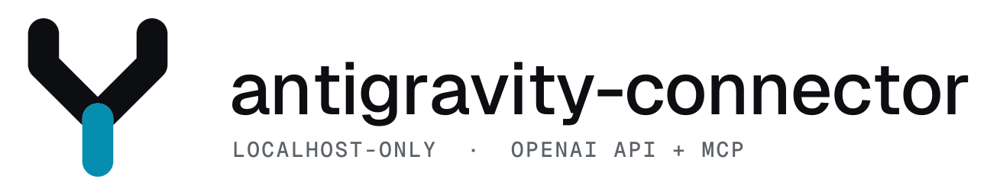

<h1 align="center">
  <picture>
    <source media="(prefers-color-scheme: dark)" srcset="design/svg/horizontal-dark.svg" />
    
  </picture>
</h1>

<p align="center">
  <strong>Use your Google AI Pro subscription as an OpenAI-compatible API and as MCP tools, from one Docker container on your own VPS, reached over HTTPS.</strong>
  <br />
  <em>A personal server on a VPS, behind HTTPS. Every call runs the official Antigravity CLI (<code>agy</code>); the app never touches your login token. Not affiliated with Google.</em>
</p>

<p align="center">
  <a href="#status"></a>
  <a href="https://github.com/guilhermebkel/antigravity-connector/actions/workflows/ci.yml"></a>
  <a href="LICENSE"></a>
  
</p>

---

**A subscription is not an API key, and taking its token is the fast way to lose the account.** Third-party tools that reused the Antigravity login token were cut off with a `403 TOS_VIOLATION`, and accounts were banned.

`antigravity-connector` does the one thing that keeps traffic coming from the official client: it runs the `agy` binary as a subprocess for every call. The server never reads, copies, logs or forwards the token, and never calls Google directly. The rules that keep it that way are lint rules and tests, not comments ([ADR 0003](docs/adr/0003-shell-out-to-agy-instead-of-using-the-token.md)).

> **The risk is lower, not zero.** Google's terms treat access through third-party software as a breach. This server is built for low, personal use: one user, one machine, one call at a time.

---

## Status

The server is built: the OpenAI-compatible API, the MCP endpoint with `web_search`, `generate_image`, `research`, `browse`, `transcribe_audio` and `analyse_video`, the Docker image, the end-to-end tests and the call log. What is still missing is in [Limits](#limits-and-what-is-not-supported-yet). The execution order is in [#29](https://github.com/guilhermebkel/antigravity-connector/issues/29) and the project brief is [#1](https://github.com/guilhermebkel/antigravity-connector/issues/1).

## What you get

<table>
<tr>
<td width="50%" valign="top">

**Two doors, one process**

An OpenAI-compatible API under `/v1` (chat with and without streaming, models, images) and an MCP server under `/mcp` over Streamable HTTP. Works from any OpenAI-compatible client or SDK and from any MCP client.

</td>
<td width="50%" valign="top">

**A shared queue**

Both doors share one global queue, which runs up to `QUEUE_CONCURRENCY` agy calls at once (4 by default; [ADR 0013](docs/adr/0013-queue-concurrency-of-four.md)), plus a daily limit per kind of run. The daily limits are the cost control for a subscription. MCP over stdio is out of scope ([ADR 0006](docs/adr/0006-api-and-mcp-in-one-process-with-one-queue.md)).

</td>
</tr>
<tr>
<td valign="top">

**Local by default**

Listens on `127.0.0.1` by default and refuses to start on any other address unless you allow it. The image listens on all interfaces so the published port works, and the install publishes it on `127.0.0.1` only, behind the HTTPS proxy. Every route but `/health` and the one-time upload links needs the bearer `API_KEY`.

</td>
<td valign="top">

**No web page, almost no state**

The login is done over HTTP: `GET /v1/auth` returns a link and `POST /v1/auth` takes the code ([ADR 0012](docs/adr/0012-login-through-the-http-api-and-mcp.md)). The only stored data is a small SQLite call log with metadata, so the daily limits survive a restart ([ADR 0010](docs/adr/0010-sqlite-call-log-and-daily-counters.md)).

</td>
</tr>
</table>

## What it can do

| Capability | Door | How it runs |
| --- | --- | --- |
| Chat | `/v1/chat/completions`, with and without streaming | `agy -p`, plan mode, no file edits |
| Web search | MCP tool `web_search` | `agy` with its search tool, answer with source URLs |
| Image generation | MCP tool `generate_image`, and `/v1/images/generations` | The native image subagent, in a fresh temporary directory |
| Research | MCP tool `research` | A longer report with links; takes minutes |
| Browsing | MCP tool `browse` | The `/browser` command with a throwaway browser profile |

Video, Google Flow, Deep Research from the Gemini app, workflows, swarms, MCP over stdio, any web page, several users and exposing the server to a network are out of scope ([ADR 0004](docs/adr/0004-scope-chat-image-search-research-and-browsing.md)).

## Risk note

Running a subscription through a server you expose to the internet is not something Google documents for the CLI. Its terms, its limits and the CLI itself can change at any time, and a call can fail or be refused. Use it for yourself, on your own machine, at a low volume. Keep the API key secret: anyone who has it can spend your daily limits.

## Requirements

- Docker with Compose.
- A Google account with an AI Pro subscription.

## Quick start

Three steps, on any VPS that runs Docker: run the server, log in once, connect your AI. Replace `connector.your-domain.com` with your own host name, and `your-api-key` with a random secret of at least 24 characters (for example `openssl rand -hex 24`).

### 1. Run the server on your VPS

The image is `ghcr.io/guilhermebkel/antigravity-connector`, public on GitHub Container Registry. No clone and no files are needed.

```bash
docker run -d --name antigravity-connector --restart unless-stopped \
  -p 127.0.0.1:8787:8787 \
  -e API_KEY='your-api-key' \
  -v agy-gemini:/home/agy/.gemini -v agy-data:/data \
  ghcr.io/guilhermebkel/antigravity-connector:latest
```

The port is published on `127.0.0.1` only. The internet reaches it through an HTTPS reverse proxy that you already run (Caddy, nginx, Traefik or a platform proxy), pointed at `127.0.0.1:8787`, with a host name (an A record) for the VPS. The two volumes keep the login and the call log: keep them, or you log in again after every update.

Check it: `curl https://connector.your-domain.com/health` answers `{"status":"ok","agy":"login_required"}` until you log in.

### 2. Log in once

Use the Google account that has the AI Pro plan. Ask for the link, open it, sign in, copy the code, and send it back within 60 seconds ([Logging in](#logging-in)):

```bash
curl -H "Authorization: Bearer your-api-key" https://connector.your-domain.com/v1/auth

curl -X POST -H "Authorization: Bearer your-api-key" -H "Content-Type: application/json" \
  -d '{"code":"the code from the login page"}' https://connector.your-domain.com/v1/auth
```

`/health` now answers `{"status":"ok","agy":"connected"}`.

### 3. Connect your AI

Any client that speaks one of two standards works. Pick the one your tool supports.

**An MCP client** (Claude, Cursor, Codex and others): add the server to its MCP settings. It uses the Streamable HTTP transport.

```json
{
  "mcpServers": {
    "antigravity": {
      "url": "https://connector.your-domain.com/mcp",
      "headers": {
        "Authorization": "Bearer your-api-key"
      }
    }
  }
}
```

The file name and the exact key names differ between clients, so check the MCP page of yours: it needs the URL and one `Authorization` header. Some clients have a command for it; for example, Claude Code: `claude mcp add --transport http antigravity https://connector.your-domain.com/mcp --header "Authorization: Bearer your-api-key"`.

**An OpenAI-compatible client** (a script, the OpenAI SDKs, the Vercel AI SDK, or any app with a "custom OpenAI endpoint" setting):

| Setting | Value |
| --- | --- |
| Base URL | `https://connector.your-domain.com/v1` |
| API key | your `API_KEY` |
| Model | `gemini-3.8-flash` (list them with `GET /v1/models`) |

### Ask

```text
Search the web for the latest stable Node.js version and give me the links.
Generate an image of a lighthouse at dusk, flat illustration.
Research the trade-offs between SQLite and Postgres for a small app, with sources.
```

Every tool call is a full agent run: a search takes tens of seconds and research takes minutes, so a call may come back as "running" first ([details](#connect-your-ai-in-detail)).

### Run it locally with Docker Compose

To try it on your own computer instead:

```bash
cp .env.example .env                 # then set API_KEY to a random value of at least 24 characters
docker compose up -d --build
curl -H "Authorization: Bearer $API_KEY" http://127.0.0.1:8787/v1/auth    # login link, if agy is not logged in yet
curl -s http://127.0.0.1:8787/health
```

To update the VPS install, pull the new image, remove the old container (`docker rm -f antigravity-connector`) and run the `docker run` command again; the login and the call log stay in their volumes.

The API key is the only access control: anyone who has it can spend your daily limits. `docker inspect` shows the value of `-e API_KEY`, so keep the VPS to yourself.

## Persistent storage on any platform

Whatever runs the container (a PaaS dashboard, Kubernetes, Compose, Nomad), it must keep two directories across redeploys:

| Directory in the container | What it keeps |
| --- | --- |
| `/home/agy/.gemini` | The agy login |
| `/data` | The call log and the daily counters |

Other settings the platform needs: the image `ghcr.io/guilhermebkel/antigravity-connector:<version>` (a release, or a branch image such as `:<branch>`), the environment variable `API_KEY`, the container HTTP port `8787`, and HTTPS on the domain.

Without the two directories, every redeploy recreates the container and the login is lost: `GET /v1/auth` starts answering `login_required` again. A platform flag that says "has persistent data" does not always mount anything; mount the directories explicitly as volumes or bind mounts. At startup the server logs `storage.checked` with `isLoginDirMounted` and `isDataDirMounted`; a `warn` line means one of the directories is not mounted. After you add them, log in once more: the directories start empty.

## Logging in

The first start has no session. The login is done over HTTP with the API key, so no shell into the container is needed:

1. Ask for the link: `GET /v1/auth` returns `{"status":"login_required","login_url":"https://accounts.google.com/...","expires_in_seconds":60}`. The MCP tool is `check_auth`.
2. Open `login_url` in a browser, sign in with the Google account that has the AI Pro plan, and copy the code the page shows.
3. Send the code within 60 seconds: `POST /v1/auth` with `{"code":"..."}` returns `{"status":"connected"}`. The MCP tool is `set_auth`. A wrong or expired code is refused; ask for a new link and try again.
4. Check: `GET /v1/auth` returns `{"status":"connected"}`, and `/health` returns `{"status":"ok","agy":"connected"}`.

The login is kept in the named volume `agy-gemini`. `docker compose down` keeps it; `docker compose down -v` removes it, and you must log in again.

## Using the API

With `curl`:

```bash
curl https://connector.your-domain.com/v1/chat/completions \
  -H "Authorization: Bearer $API_KEY" -H "Content-Type: application/json" \
  -d '{"model":"gemini-3.8-flash","reasoning_effort":"low","messages":[{"role":"user","content":"Say hello in one word."}]}'
```

With the Vercel AI SDK (`@ai-sdk/openai-compatible`):

```ts
import { createOpenAICompatible } from "@ai-sdk/openai-compatible";
import { generateText } from "ai";

const provider = createOpenAICompatible({
  name: "antigravity",
  baseURL: "https://connector.your-domain.com/v1",
  apiKey: process.env.API_KEY,
});
const { text } = await generateText({ model: provider("gemini-3.8-flash"), prompt: "Say hello in one word." });
```

More endpoints and options:

- `POST /v1/images/generations` returns one PNG as `data[0].b64_json`. `n` other than 1 and `response_format` other than `b64_json` return 400.
- `response_format` with `{"type":"json_schema","json_schema":{"name":"x","schema":{...}}}` returns the JSON as the message content. `json_object` returns any JSON object. A streamed structured answer is sent once, at the end.
- An `image_url` part with a base64 `data:` URL (PNG, JPEG or WebP, up to 4 MiB each, four per request) is saved for the run. Remote URLs are refused, and nothing is fetched.
- `conversation_id` from a previous response continues that conversation: send the new message only. The id is kept for 24 hours, in memory; after a restart, or once it expires, send the full history without it.

## Connect your AI in detail

The setup is in [Quick start](#3-connect-your-ai). This section says what each door gives your AI.

### MCP tools (`/mcp`)

Any MCP client that supports Streamable HTTP can use them: it sends the URL and the `Authorization: Bearer <API_KEY>` header. The tools are `web_search`, `generate_image`, `transcribe_audio`, `analyse_video`, `create_upload_link`, `research`, `browse`, `get_result`, `check_usage`, `check_auth` and `set_auth`.

The `web_search` tool returns a short answer with links. A search takes about 20 to 45 seconds and counts against `DAILY_LIMIT_SEARCH`.

The `generate_image` tool returns one PNG image. A call takes about a minute and counts against `DAILY_LIMIT_IMAGE`. The image model has its own quota on the subscription: when it is used up, the call says so with the time it resets, and the server refuses image calls until then, without starting an agy run ([ADR 0018](docs/adr/0018-image-quota-gate.md)). It can take up to four reference images in `images`, each a base64 `data:` URL, an `https://` URL or an `upload:` value from `create_upload_link`, of a PNG, JPEG or WebP file of up to 4 MiB. The server downloads an `https://` URL itself ([ADR 0014](docs/adr/0014-reference-images-by-https-url.md)): it follows at most 3 redirects (https only), gives up after 15 seconds and refuses, on every hop, a host that resolves to a private, loopback or link-local address. The chat API still takes `data:` URLs only.

A photo that sits on your own machine has no public URL, and a long base64 string is easy to corrupt when a model copies it. The `create_upload_link` tool returns a one-time path, `/upload/<token>`, an `upload:<id>` value and, when `PUBLIC_URL` is set, the full `uploadUrl`. Send the file as the raw body of a `POST` to that path on your server, with no key, because the link is the credential (`curl --data-binary @photo.jpg https://connector.your-domain.com/upload/<token>`), then put the `upload:<id>` value in `images`. A link works once and lasts 5 minutes, the file is kept in memory for 15 minutes, and at most 8 links and files wait at a time ([ADR 0015](docs/adr/0015-upload-link-for-reference-images.md)).

The `transcribe_audio` and `analyse_video` tools read a file that was uploaded first: call `create_upload_link` with `kind` `audio` or `video`, send the file to its path, then pass the `file` value it returned. `transcribe_audio` takes MP3, WAV, M4A, AAC, OGG, FLAC or WebM audio of up to 20 MiB and returns the transcript, with an optional `language` and a `format` of `plain` or `timestamped`. `analyse_video` takes MP4, MOV, WebM or AVI video of up to 30 MiB, with its sound, and answers a `question` about it. Both count against `DAILY_LIMIT_MEDIA`, and the file is data: instructions in it are ignored ([ADR 0017](docs/adr/0017-audio-and-video-tools-by-upload.md)). The server holds at most 60 MiB of uploads at once.

The long MCP tools (`web_search`, `generate_image`, `research`, `browse`, `transcribe_audio` and `analyse_video`) wait about 20 seconds for their result. If it is not ready, they return `status` `running` and a `job_id`; call `get_result` with that `job_id` after `retry_after_seconds` until it returns the result. A client that cancels during the first 20 seconds stops the run; after that the run goes on without the client, and the result is kept for 10 minutes. The OpenAI-compatible API does not use jobs.

The `research` tool writes a Markdown report with a source link for each claim. A call takes several minutes (up to 10), spends tens of thousands of tokens, and counts against `DAILY_LIMIT_RESEARCH`. The report is capped at 20000 characters, and `truncated` says when it was cut.

The `check_usage` tool shows how much of the subscription limits is left: for each group of models (for example `Gemini Models`), the percent left of the 5-hour and the weekly limit, and when each refills. It runs agy's own `/usage` command, which sends no model call and spends no quota, and the answer is cached for 30 seconds. The server's daily call limits are separate and are not in it; the image model's own quota does not show there either.

The `browse` tool opens a public page in headless Chrome, reads it or does a simple task, and can return a screenshot. It has no logins and no saved cookies. Loopback and private addresses, and URLs with a user name or password, are refused. A call counts against `DAILY_LIMIT_BROWSE`. Pages may contain instructions; the tool treats them as data.

When the client sends a progress token, the server reports progress while a call waits in the queue and runs. A client that cancels a call stops the agy process.

## Configuration

| Variable | Default | What it does |
| --- | --- | --- |
| `API_KEY` | none (required, at least 24 characters) | The bearer token every route except `/health` and the upload links requires. |
| `HOST` | `127.0.0.1` (`0.0.0.0` in the image) | The address the server listens on. |
| `ALLOW_NON_LOOPBACK_BIND` | `false` (`true` in the image) | Allows a non-loopback `HOST`. The image sets it so the port can be published on the host. Publish it on `127.0.0.1` only and put an HTTPS proxy in front. |
| `PORT` | `8787` | The port. |
| `AGY_BIN` | `agy` | The agy binary. |
| `AGY_TIMEOUT_MS` | `300000` | A call that runs longer is stopped. An image call is stopped at 60 percent of this value, and research at twice. |
| `AGY_OUTPUT_WAIT_MS` | `30000` | For an image call, how long to keep waiting for `output.png` after agy says it is done. The call fails with the agy answer if the file does not appear. |
| `QUEUE_MAX_WAIT_MS` | `120000` | A call that waits longer in the queue is refused. |
| `QUEUE_CONCURRENCY` | `4` | Agy runs in flight at once, from `1` to `8`. Calls past this wait in the queue. |
| `DAILY_LIMIT_CHAT` / `_SEARCH` / `_IMAGE` / `_RESEARCH` / `_BROWSE` / `_MEDIA` | `200` / `50` / `20` / `5` / `20` / `20` | Calls per UTC day, per kind. `0` refuses that kind. |
| `HTTP_MAX_REQUESTS_PER_MINUTE` | `120` | Requests per minute, counted separately for failed and valid authentications. |
| `DATA_DIR` | `data` (`/data` in the image) | Where the SQLite call log (`calls.sqlite`) is kept. It holds metadata only: no prompts, responses, queries, URLs or images. Rows older than 90 days are deleted at startup. |
| `PUBLIC_URL` | none | The public origin of the server, such as `https://connector.your-domain.com`. When it is set, `create_upload_link` also returns the full `uploadUrl`; without it, the client joins `uploadPath` to the host it already uses. |
| `MCP_MAX_SESSIONS` | `8` | MCP sessions open at once. |
| `MCP_SESSION_TTL_MS` | `1800000` | An MCP session idle for longer expires. |

## How it works

```text
  client ──▶ 1. AUTH ──▶ 2. VALIDATE ──▶ 3. LIMIT + QUEUE ──▶ 4. RUN agy ──▶ 5. REPLY
  (/v1, /mcp)  bearer key   strict Zod      daily limit, then    fresh empty    OpenAI shape
               SHA-256      schemas         the one global       temp dir,      or MCP result,
                                            queue                timeout        logs: metadata only
```

The work is split into packages on purpose, and the direction of the imports is a lint rule:

| Package | Does | Why |
| --- | --- | --- |
| `apps/server` | Fastify; mounts the API, the MCP endpoint and `/health` | It only mounts; no rule lives here |
| `packages/api` | The OpenAI-compatible routes | Nothing outside the OpenAI format; never imports `agy` |
| `packages/mcp` | The tool manifest, input and output schemas | Never imports `agy` or `api` |
| `packages/core` | The queue, the daily limits, the session state, the environment, the logging | One place enforces the limits for both doors |
| `packages/agy` | The only place that spawns the binary, and the fake `agy` for tests | The only package that may import `child_process` |
| `packages/protocol` | Shared types and Zod schemas | Imports no other package |

Decisions are in [`docs/adr/`](docs/adr/), vocabulary in [`GLOSSARY.md`](GLOSSARY.md).

## Limits and what is not supported yet

- Up to `QUEUE_CONCURRENCY` agy calls run at once (4 by default). Calls from the API and from MCP share one queue, and the rest wait.
- Calls are slow: a chat answer takes seconds, a search takes tens of seconds.
- Streaming works with `stream: true` (Server-Sent Events, OpenAI chunk format). Set `stream_options.include_usage` to get the usage in the last chunk.
- Not available yet: tool calling (`tools` returns 400, because agy runs its own tools), PDF and other file input, audio and video in the chat API (the MCP tools `transcribe_audio` and `analyse_video` take them), and a browser profile with your own logins.
- `browse` runs Chrome through agy's `/browser` command. The temporary directory of each run is removed after it; agy chooses where its Chrome profile lives, and no flag sets that, so the profile is not confined to the run directory yet.
- Sampling parameters (`temperature`, `top_p`, `max_tokens`, `max_completion_tokens`) are accepted and ignored. The response header `x-antigravity-connector-ignored-params` lists the ones you sent.
- The agy binary is pinned to version 1.5.18 in the image. It cannot update itself, because it is installed read-only for the server user.

## Troubleshooting

- **`/health` says `login_required` after a restart.** The login is gone: the volume was removed or the image was rebuilt without it. Log in again (see above). A restart or a recreate with the same volume keeps the login.
- **`503` with `queue_timeout`.** Another call held the queue longer than `QUEUE_MAX_WAIT_MS`. Retry in a moment.
- **`429` with `daily_limit_reached`.** The limit for that kind is used up. It resets at the next UTC midnight, and the message says when.
- **`504` with `agy_timeout`.** The call ran longer than `AGY_TIMEOUT_MS` and was stopped. Ask a shorter question.
- **`502` with `agy_failed`.** agy failed. The container logs show the cause without the prompt or the answer.
- **The container stops at once with a message about `API_KEY`.** `.env` is missing the key, or the key is shorter than 24 characters.

## Privacy and safety

- **The login token stays with `agy`.** No source file names its credentials folder (lint rule), and the app never reads, copies, logs or forwards it.
- **Logs carry metadata only:** door, route or tool, model, duration and token counts. Never a message, a search query, a prompt, image bytes or the `API_KEY`. Every output path is tested with a fake secret.
- **Every run is boxed:** a fresh empty temporary directory, a timeout that kills the process, and plan mode for chat, search and research. Browsing always uses a throwaway profile.
- **The only network exit is the `agy` binary.** No telemetry, no analytics.

Found a way around any of this? Open an issue without secrets in it.

## How it compares

- **Using the token directly (a proxy that calls Google's internal API)** is what got accounts banned. Here the token never leaves the CLI.
- **A generic OpenAI proxy** gives every client the whole subscription with no queue and no limits. Here there is one queue, a daily limit per kind of run, an API key and HTTPS in front.

## FAQ

<details>
<summary><b>Can I expose it to the internet or share it with other people?</b></summary>

No. It is a single-user server, reachable over HTTPS with an API key, and the subscription is yours. The bind guard refuses another address unless `ALLOW_NON_LOOPBACK_BIND=true`, which only the Docker image sets; the install and an HTTPS proxy is the public entry.

</details>

<details>
<summary><b>Why is there no login page?</b></summary>

There is no web page on purpose. When there is no session, `GET /v1/auth` (or the `check_auth` tool) returns a login link; you open it, sign in, and send the code to `POST /v1/auth` (or `set_auth`). `/health` says whether the session is connected, as seen by a real `agy` check, never by configuration ([ADR 0009](docs/adr/0009-no-web-page-login-through-docker-exec.md)). The landing page is a separate static folder, `site/` ([ADR 0011](docs/adr/0011-landing-page-and-logo-in-the-repository.md)).

</details>

<details>
<summary><b>Does the login survive a container restart?</b></summary>

Yes, as long as the named volume `agy-gemini` is kept. `docker compose down` keeps it and `docker compose down -v` removes it, so you would log in again. Details are in [`docs/spike-results.md`](docs/spike-results.md).

</details>

## Roadmap

The full order, in groups, is in [#29](https://github.com/guilhermebkel/antigravity-connector/issues/29).

- [x] **Harness and structure:** monorepo, lint rules, architecture tests, CI and docs.
- [x] **Spike:** `agy` inside Docker, login and session persistence.
- [x] **Chat over `/v1`**, with streaming, structured output, conversations and image input.
- [x] **MCP** with `web_search`, `generate_image`, `research`, `browse`, `transcribe_audio` and `analyse_video`.
- [x] **Docker image, end-to-end tests and the real acceptance run** ([`docs/acceptance-2026-11.md`](docs/acceptance-2026-11.md)).
- [ ] **Not available yet:** tool calling, PDF and other file input, audio and video in the chat API, a browser profile with your own logins.

## Contributing

Issues and pull requests are welcome. Start with [`AGENTS.md`](AGENTS.md), which says what to read for each kind of task.

### Development

Needs the Node version in `.nvmrc` and pnpm.

```bash
nvm use
pnpm install
pnpm dev     # the server with the fake agy on 127.0.0.1:8787
pnpm check   # typecheck, lint, quality, tests and build
```

The image smoke test is `scripts/image-smoke.sh` (it needs Docker).

A release is started by hand: run the `Release` workflow on `master` and pick `patch`, `minor` or `major` (`none` releases the current version). It checks everything, tags the commit, publishes the GitHub Release and the image to `ghcr.io/guilhermebkel/antigravity-connector`.

---

<p align="center">
  <strong>Your subscription. Your server. Any AI.</strong>
</p>

<p align="center">
  MIT License &copy; Guilherme Mota
</p>
